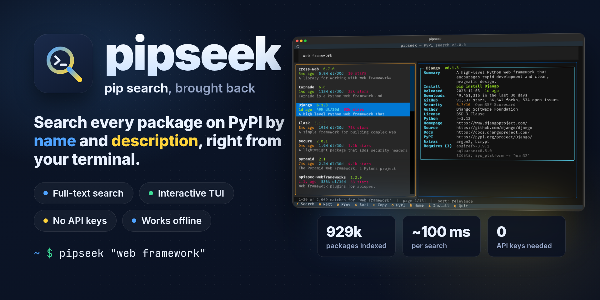
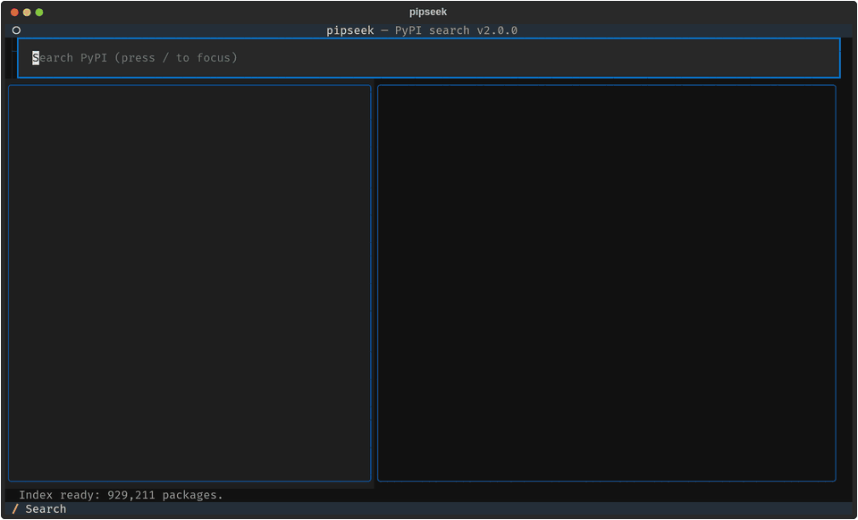
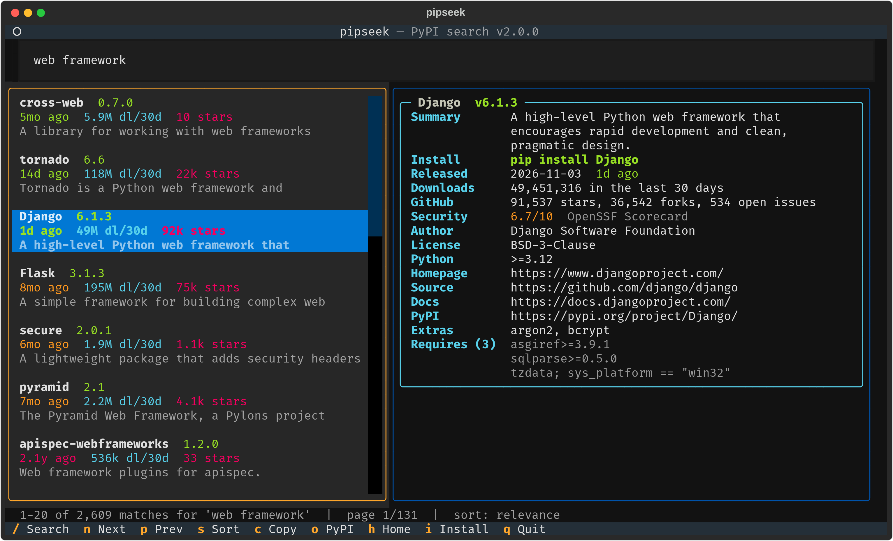
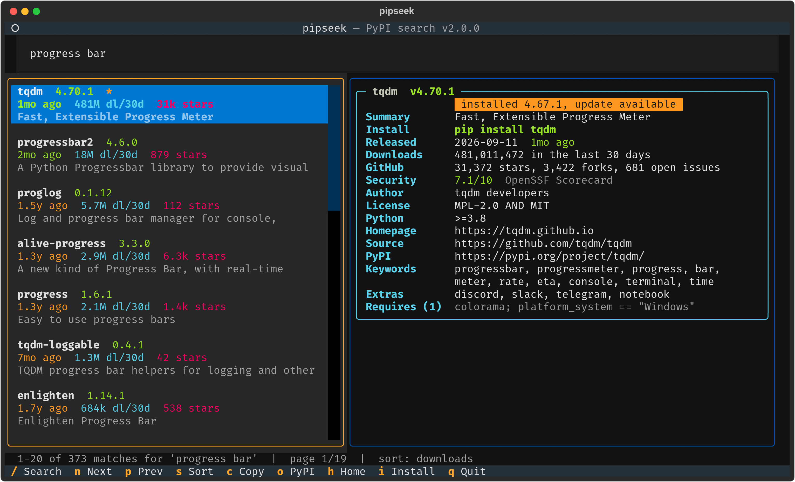
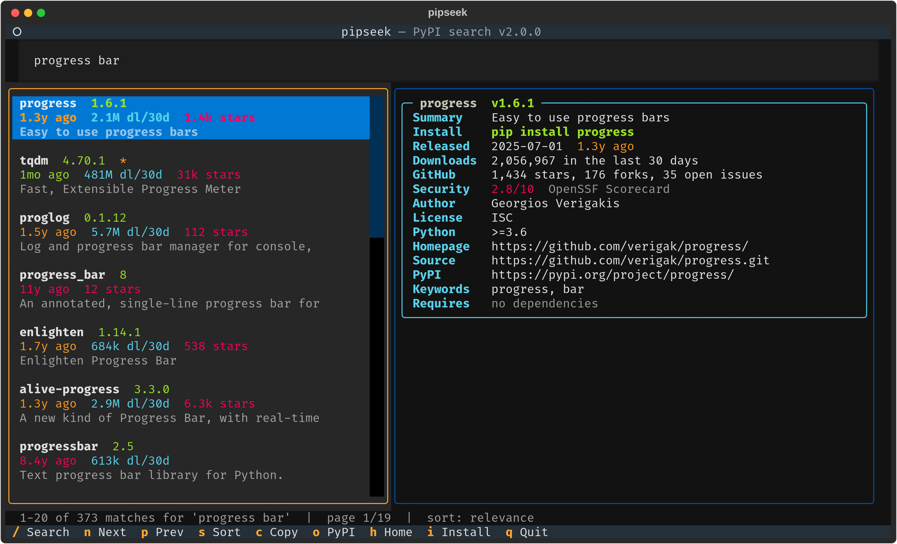
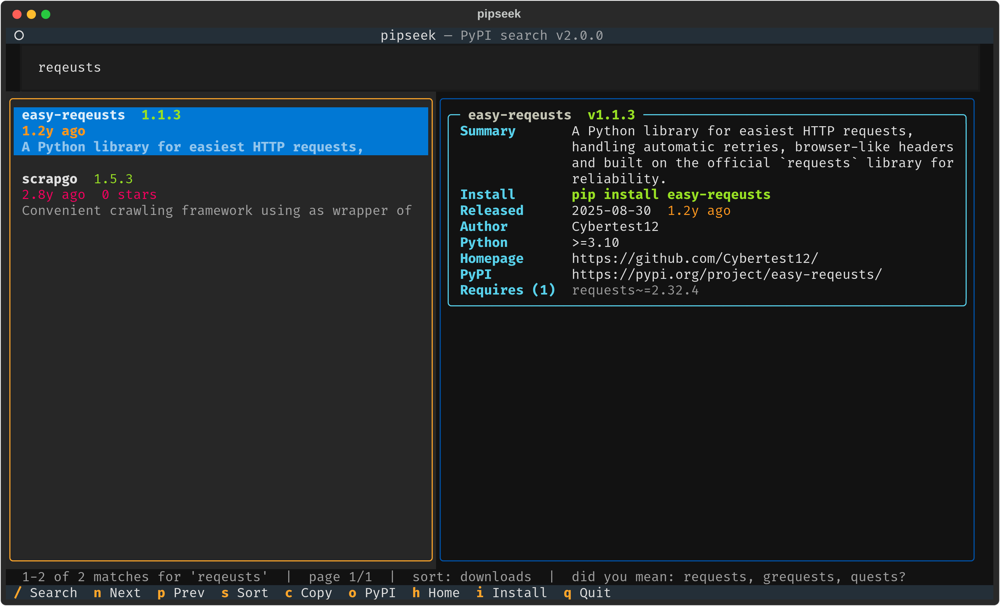
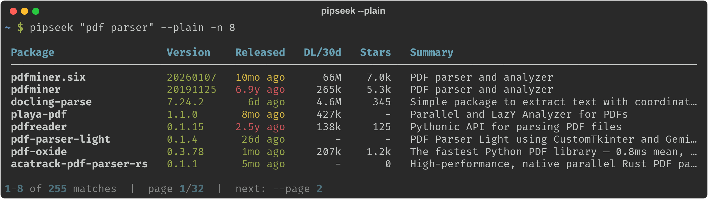
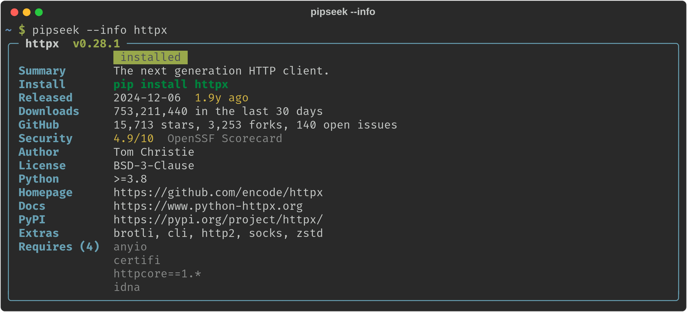
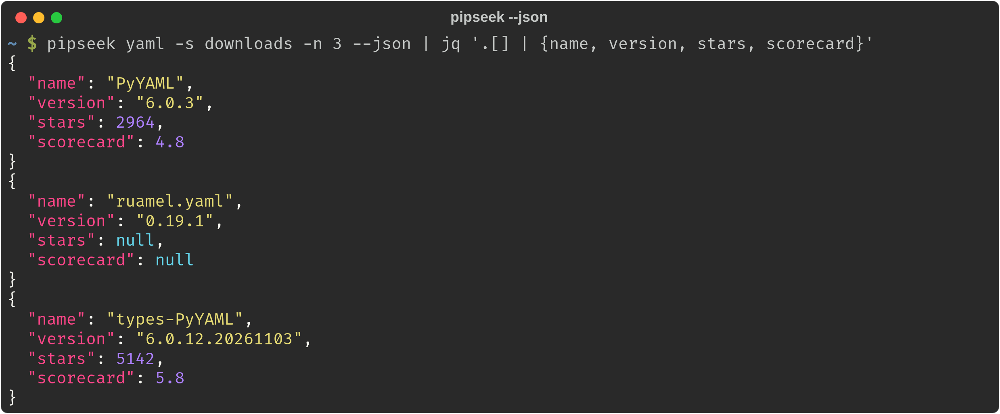
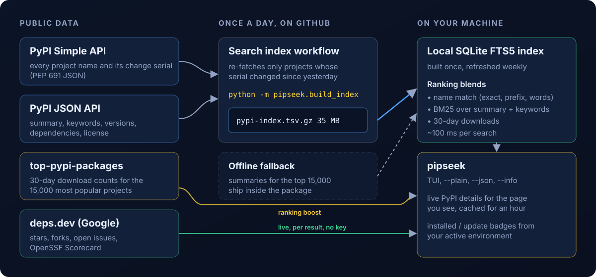

<div align="center">



# pipseek

**Search all of PyPI from your terminal, by name and description.  The `pip search` that PyPI switched off, rebuilt with a full-text index, an interactive TUI and no API keys.**

[](https://github.com/ohmybahgosh/pipseek/actions/workflows/ci.yml)
[](https://github.com/ohmybahgosh/pipseek/releases/tag/index)
[](pyproject.toml)
[](https://github.com/Textualize/textual)
[](#where-the-data-comes-from)
[](LICENSE)
[](https://github.com/ohmybahgosh/pipseek/stargazers)

</div>

`pip search` stopped working years ago, and scraping `pypi.org/search` doesn't work either, because that page now sits behind a browser challenge.  pipseek keeps its own full-text index of all ~930,000 projects on PyPI, searches it locally in about 100 ms, and pulls live details for the results you're looking at.  It uses only public APIs: no scraping, no accounts, no keys.

```bash
pipx install git+https://github.com/ohmybahgosh/pipseek
pipseek "web framework"
```

> [!NOTE]
> **How this is built.**  pipseek v1 (early 2025) was one script that scraped PyPI's search page and got past its bot challenge.  v2.0 is a ground-up rewrite written with AI coding agents (Claude), directed, reviewed and tested by me, [OhMyBahGosh](https://github.com/ohmybahgosh).  I've been building software for over 17 years.  My day job is data engineering, and network security and pentesting are what I do for fun.  AI writes a lot of the code here; I decide what it does, check how it does it, and nothing ships until it's run on my own Linux desktop against the real PyPI.
>
> That real-world testing is what shaped v2: dropping the bot-challenge workaround in favor of PyPI's official APIs, tuning the ranking against the full 930k-package index so unused placeholder packages stop outranking Django, replacing GitHub's rate-limited API with keyless [deps.dev](https://deps.dev) stats, and catching a plain-mode crash before it shipped.  The [changelog](CHANGELOG.md) has the details.
>
> - **Tests on every push:** [pytest](tests/test_pipseek.py) covers ranking, description search, typo suggestions, paging, parsing PyPI metadata, the index file format, the CLI's plain and JSON modes and the detail card, plus `ruff` linting.  CI runs it on Linux, macOS and Windows with Python 3.9 and 3.13.  The CI badge above shows the latest run.
> - **Read-only by default:** pipseek only reads public data and writes to its own cache folder.  The one exception is the `i` key in the TUI, which runs `pip install` in your environment after showing you the exact command.
>
> Commits list me as the author and Claude as the committer, which is why they show as Verified.  Found a problem?  [Open an issue](https://github.com/ohmybahgosh/pipseek/issues/new).

## Contents

- [See it in action](#see-it-in-action)
- [Features](#features)
- [Install](#install)
- [Usage](#usage)
  - [Interactive mode](#interactive-mode)
  - [Plain, JSON and info modes](#plain-json-and-info-modes)
  - [Options](#options)
- [How it works](#how-it-works)
- [Where the data comes from](#where-the-data-comes-from)
- [Search tips](#search-tips)
- [FAQ](#faq)
- [Development](#development)
- [Credits](#credits)
- [License](#license)

## See it in action

<p align="center">
  
</p>

<table>
  <tr>
    <td width="50%"></td>
    <td width="50%"></td>
  </tr>
  <tr>
    <td align="center"><b>Searches descriptions, not just names</b></td>
    <td align="center"><b>Sort by downloads, see what's installed</b></td>
  </tr>
  <tr>
    <td width="50%"></td>
    <td width="50%"></td>
  </tr>
  <tr>
    <td align="center"><b>Security score at a glance</b></td>
    <td align="center"><b>"Did you mean?" for typos</b></td>
  </tr>
</table>

## Features

- **Full-text search** over every project's name, summary and keywords.  `pipseek "progress bar"` finds tqdm, `pipseek "web framework"` finds Django, Flask and Tornado, and `pipseek requests` still puts `requests` first.
- **Ranked the way you'd expect:** exact and prefix name matches, BM25 relevance over descriptions, and real 30-day download counts, so popular packages beat empty placeholders.
- **Interactive TUI** built on [Textual]: a search box, a results list and a detail pane that follows your cursor.
- **Rich details:** version, release age (green, yellow or red by freshness), downloads, stars and forks, open issues, the [OpenSSF Scorecard](https://securityscorecards.dev) security score, author, license, Python requirement, links, extras and dependencies.
- **Knows your environment:** marks packages already installed in your active virtualenv (or `python3` on your PATH) and flags available updates.
- **One-key actions:** copy the install command, open PyPI or the repo in your browser, or install and upgrade without leaving the TUI.
- **"Did you mean?"** suggestions for typos, drawn from popular packages first.
- **Script-friendly:** `--plain` prints a table, `--json` gives structured output for `jq`, and piped output switches to plain mode on its own.
- **No API keys, no accounts:** everything comes from public, keyless APIs.
- **Fast and offline-friendly:** the index lives in a local SQLite full-text database.  After the first run, searches don't need the network, and details are cached for an hour.

## Install

[pipx](https://pipx.pypa.io/) or [uv](https://docs.astral.sh/uv/) keep pipseek in its own isolated environment, which is the cleanest way:

```bash
pipx install git+https://github.com/ohmybahgosh/pipseek
# or
uv tool install git+https://github.com/ohmybahgosh/pipseek
```

Plain pip works too:

```bash
pip install git+https://github.com/ohmybahgosh/pipseek
```

Upgrade later with `pipx upgrade pipseek` or `uv tool upgrade pipseek`.

The first run downloads the search index (about 35 MB) and builds a local database from it, which takes about 10 seconds.  After that it refreshes on its own once a week, or whenever you pass `--refresh`.

> [!TIP]
> **Upgrading from v1?**  The old `pipseek` was a single script, usually copied to `/usr/local/bin/pipseek`.  Remove it with `sudo rm /usr/local/bin/pipseek` so it doesn't shadow the new one, then run `hash -r` or open a new terminal.

## Usage

### Interactive mode

```bash
pipseek                   # open the TUI with an empty search box
pipseek fastapi           # open the TUI and search right away
pipseek "pdf parser"      # multi-word searches match descriptions too
```

| Key | Action |
| --- | --- |
| `/` | Focus the search box (`Enter` runs the search) |
| `↑` `↓` or `j` `k` | Move through results; the detail pane follows |
| `n` / `p` | Next / previous page |
| `s` | Cycle the sort: relevance, downloads, updated, name, stars |
| `c` | Copy `pip install <name>` to the clipboard |
| `o` | Open the package on PyPI |
| `h` | Open the project's repository or homepage |
| `i` | `pip install` it, or upgrade it if a newer version is out |
| `Esc` | Jump from the search box back to the results |
| `q` | Quit |

The `i` key installs into the same environment pipseek checks for installed packages: your active virtualenv or conda env, otherwise the first `python3` on your PATH.  Use `--python` to pick a different one.

### Plain, JSON and info modes

<p align="center">
  
</p>

<table>
  <tr>
    <td width="50%"></td>
    <td width="50%"></td>
  </tr>
  <tr>
    <td align="center"><b><code>--info</code> for one package</b></td>
    <td align="center"><b><code>--json</code> for scripts</b></td>
  </tr>
</table>

```bash
pipseek "pdf parser" --plain -n 8          # a table instead of the TUI
pipseek http -s downloads -n 10            # top 10 matches by downloads
pipseek --info requests                    # the full detail card for one package
pipseek django --json | jq '.[] | {name, version, released, stars}'
pipseek yaml --plain --page 2              # the next page of results
```

### Options

| Option | Description |
| --- | --- |
| `-i, --info PACKAGE` | Show the full detail card for one package |
| `-P, --plain` | Print a table instead of opening the TUI |
| `-j, --json` | Print results as JSON |
| `-n, --limit N` | Results per page (default 20) |
| `-p, --page N` | Page number |
| `-s, --sort` | `relevance`, `downloads`, `updated`, `name` or `stars` |
| `--python PATH` | Interpreter used for installed checks and `i` installs |
| `--no-stats` | Skip repository stats (stars, forks, security score) |
| `--refresh` | Download the search index again now |
| `--clear-cache` | Delete everything pipseek has cached |
| `-V, --version` | Print the version |

`relevance`, `downloads` and `name` sort all matches.  `updated` and `stars` need live data, so they sort the page you're on.

| Environment variable | Purpose |
| --- | --- |
| `PIPSEEK_CACHE_DIR` | Use a different cache folder |
| `PIPSEEK_INDEX_URL` | Use a different prebuilt search index |
| `VIRTUAL_ENV` / `CONDA_PREFIX` | Picked up automatically to decide which environment counts as "installed" |

## How it works

<p align="center">
  
</p>

PyPI has no public full-text search API, so pipseek brings its own index:

1. **A daily GitHub Action** ([`index.yml`](.github/workflows/index.yml)) runs [`pipseek.build_index`](src/pipseek/build_index.py).  The PyPI Simple API reports a change serial for every project, so the build only re-fetches projects that changed since yesterday, usually a few thousand.  It publishes `pypi-index.tsv.gz` (name, summary and keywords for every project) on the [`index` release](https://github.com/ohmybahgosh/pipseek/releases/tag/index).
2. **On your machine,** pipseek downloads that file and builds a SQLite FTS5 database from it, once a week.
3. **Each search** combines name matches, BM25 relevance over summaries and keywords, and 30-day download counts, then fetches live details for just the page you're viewing.
4. **If the release can't be reached,** pipseek falls back to every project name from PyPI plus summaries for the 15,000 most popular projects, which ship inside the package, and tries for the full index again the next day.

## Where the data comes from

| Data | Source | Key needed? |
| --- | --- | --- |
| Every project name and change serial | [PyPI Simple API](https://peps.python.org/pep-0691/) | No |
| Summaries, keywords, versions, dependencies | [PyPI JSON API](https://docs.pypi.org/api/json/) | No |
| 30-day download counts | [top-pypi-packages](https://github.com/hugovk/top-pypi-packages) by Hugo van Kemenade | No |
| Stars, forks, open issues, OpenSSF Scorecard | [deps.dev](https://deps.dev) by Google (GitHub, GitLab and Bitbucket projects) | No |

pipseek identifies itself to these services as `pipseek/<version>` with a link to this repo.  The index workflow uses only the token GitHub gives every Action run, so there are no secrets to set up.

## Search tips

- **Describe what you want:** `pipseek "async http client"`, `pipseek "markdown to pdf"`, `pipseek "json schema validation"`.
- **Or type the name:** an exact name always comes first, and close names follow (`requests`, `requests-oauthlib`, `requests-toolbelt`).
- **Sort by downloads** (`s` in the TUI, `-s downloads` on the command line) when you want the safe, popular choice.
- **Check the Security row** before adopting something new.  It's the project's [OpenSSF Scorecard](https://securityscorecards.dev): green is 7 or higher, yellow is 4 to 7, red is under 4.

## FAQ

**Why not just use pypi.org/search?**  You can in a browser, but it can't be scripted any more: it sits behind a JavaScript challenge meant to stop bots.  pipseek doesn't try to get around that.  It uses PyPI's official APIs instead, which are made for tools.

**How fresh are the results?**  The index is rebuilt every day, and pipseek downloads it weekly.  Versions, release dates and stats for the results you look at are always live (cached for an hour).

**How much disk space does it use?**  About 175 MB for the search database, in `~/.cache/pipseek` on Linux, `~/Library/Caches/pipseek` on macOS, or `%LOCALAPPDATA%\pipseek` on Windows.  `pipseek --clear-cache` removes it.

**Does it work offline?**  Searching does, once the index is built.  The detail pane needs the network for anything it hasn't cached yet.

**Why is a package marked "installed" when I installed it somewhere else?**  pipseek checks one environment: your active virtualenv or conda env, otherwise the first `python3` on your PATH.  Pass `--python /path/to/python` to check a different one.

**Can I build the index myself?**  Yes: `python -m pipseek.build_index --out pypi-index.tsv.gz` builds all of PyPI in about 30 minutes, then point pipseek at it with `PIPSEEK_INDEX_URL`.

## Development

```bash
git clone https://github.com/ohmybahgosh/pipseek
cd pipseek
pip install -e ".[dev]"
ruff check src tests
pytest
```

The code lives in [`src/pipseek`](src/pipseek): `index.py` (local search index and ranking), `build_index.py` (the index builder), `pypi.py` (PyPI and deps.dev clients), `search.py`, `tui.py`, `render.py` and `cli.py`.  Issues and pull requests are welcome.

## Credits

- [Textual](https://github.com/Textualize/textual) and [Rich](https://github.com/Textualize/rich) by Will McGugan and Textualize, for the TUI and terminal output.
- [top-pypi-packages](https://github.com/hugovk/top-pypi-packages) by Hugo van Kemenade, for download counts.
- [deps.dev](https://deps.dev) by Google, for repository stats and OpenSSF Scorecard results.
- The Python Packaging Authority and the PyPI team, for the Simple and JSON APIs.

## License

[GPL-3.0-or-later](LICENSE).  Made by [OhMyBahGosh](https://github.com/ohmybahgosh).
