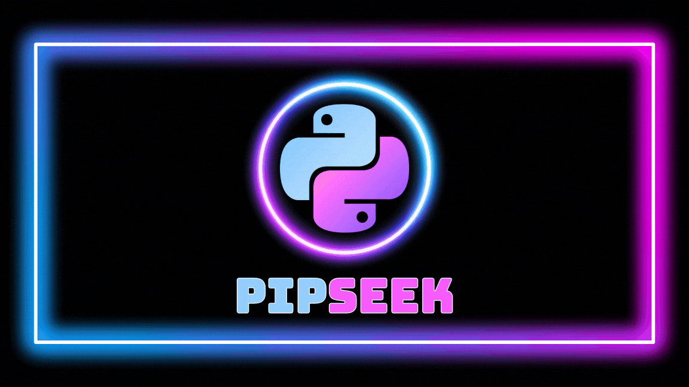

<p align="center">
  
</p>

<p align="center">
  <b>Search PyPI from your terminal.</b><br>
  A fast, interactive replacement for the retired <code>pip search</code>.
</p>

<p align="center">
  <a href="https://github.com/ohmybahgosh/pipseek/actions/workflows/ci.yml"></a>
  
  
</p>

## Why pipseek?

`pip search` was switched off years ago, and scraping `pypi.org/search` no longer works because the page now sits behind a browser challenge.  pipseek takes a different route: it keeps a local full-text index of every project on PyPI (names, summaries, and keywords), searches it in milliseconds, and pulls live details for each result from the PyPI JSON API.  No scraping, no API keys, no fragile workarounds, and it works offline once the index is cached.

## Features

- **Interactive TUI** built on [Textual]: live search box, scrollable results, and a detail pane for the highlighted package.
- **Searches names and descriptions**: `pipseek "progress bar"` finds `tqdm`, `pipseek "web framework"` finds Flask and Django, and `pipseek requests` still puts `requests` first.
- **Popularity-aware ranking**: name and description relevance, boosted by real 30-day download counts.
- **Rich package details**: version, release age (color-coded by freshness), downloads, stars, an OpenSSF security score, author, license, Python requirement, homepage, source, docs, extras, and dependencies.
- **Knows your environment**: marks packages already installed in your active venv (or `python3` on PATH) and flags available updates.
- **One-key actions**: copy the install command, open PyPI or the project's repo, or `pip install`/upgrade straight from the results.
- **"Did you mean?"** suggestions for typos (`reqeusts` → `requests`).
- **Script-friendly**: `--plain` prints a table, `--json` emits structured output for `jq` and friends.  Piped output switches to plain mode automatically.
- **Fast and offline-friendly**: the index lives in a local SQLite full-text database and refreshes weekly; package details are cached for an hour.

## Install

The recommended way is [pipx] or [uv], which keep pipseek in its own isolated environment:

```bash
pipx install git+https://github.com/ohmybahgosh/pipseek
# or
uv tool install git+https://github.com/ohmybahgosh/pipseek
```

Plain pip works too:

```bash
pip install git+https://github.com/ohmybahgosh/pipseek
```

For development:

```bash
git clone https://github.com/ohmybahgosh/pipseek
cd pipseek
pip install -e ".[dev]"
pytest
```

## Usage

```bash
pipseek                          # open the interactive search
pipseek fastapi                  # search and browse results
pipseek "pdf parser" --plain     # print a table instead of opening the TUI
pipseek http -s downloads -n 10  # top 10 matches by downloads
pipseek --info requests          # full details for one package
pipseek django --json | jq '.[] | {name, version, released}'
```

The first run downloads the search index and builds a local database, which takes about a minute.  After that it is cached and refreshed weekly (`--refresh` forces it).

### Keys

| Key | Action |
| --- | --- |
| `/` | Focus the search box (`Enter` runs the search) |
| `↑` `↓` / `j` `k` | Move through results |
| `n` / `p` | Next / previous page |
| `s` | Cycle sort: relevance, downloads, updated, name, stars |
| `c` | Copy `pip install <name>` to the clipboard |
| `o` | Open the package on PyPI |
| `h` | Open the project's repository or homepage |
| `i` | `pip install` (or upgrade) into your environment |
| `Esc` | Jump from the search box to the results |
| `q` | Quit |

### Options

| Option | Description |
| --- | --- |
| `-i, --info PACKAGE` | Show full details for one package |
| `-P, --plain` | Print results instead of opening the TUI |
| `-j, --json` | Print results as JSON |
| `-n, --limit N` | Results per page (default 20) |
| `-p, --page N` | Page number |
| `-s, --sort` | `relevance`, `downloads`, `updated`, `name`, or `stars` |
| `--python PATH` | Interpreter used for installed checks and installs |
| `--no-stats` | Skip repository stats (stars, forks, security score) |
| `--refresh` | Re-download the search index now |
| `--clear-cache` | Delete all cached data |

### Environment variables

| Variable | Purpose |
| --- | --- |
| `PIPSEEK_CACHE_DIR` | Override the cache location |
| `PIPSEEK_INDEX_URL` | Use a different prebuilt search index |
| `VIRTUAL_ENV` / `CONDA_PREFIX` | Picked up automatically to decide which environment counts as "installed" |

## How it works

PyPI has no public full-text search API, so pipseek maintains its own index:

1. A scheduled GitHub Action in this repo ([`index.yml`](.github/workflows/index.yml)) runs [`pipseek.build_index`](src/pipseek/build_index.py) daily.  It reads the project list and per-project serial numbers from the [PyPI Simple API], re-fetches only the projects that changed since the last run from the [PyPI JSON API], and publishes `pypi-index.tsv.gz` (name, summary, keywords for every project) on the [`index` release](https://github.com/ohmybahgosh/pipseek/releases/tag/index).
2. On first run, pipseek downloads that file (about 35 MB) and builds a local SQLite FTS5 database from it (about 10 seconds, roughly 175 MB on disk, refreshed weekly).
3. If the release can't be reached, pipseek falls back to every project name from the PyPI Simple API plus summaries for the ~15,000 most popular projects, which ship inside the package.

| Data | Source |
| --- | --- |
| Names, summaries, keywords | pipseek index release, built from the [PyPI Simple API] and [PyPI JSON API] |
| 30-day download counts | [top-pypi-packages] by Hugo van Kemenade |
| Live package details | [PyPI JSON API] |
| Stars, forks, open issues, OpenSSF Scorecard | [deps.dev] by Google (free, no key, covers GitHub/GitLab/Bitbucket) |

Results are ranked by combining name matches (exact, prefix, and word matches, insensitive to case and `-`/`_`/`.`), BM25 relevance over summaries and keywords, and download popularity.

To build the index yourself: `python -m pipseek.build_index --out pypi-index.tsv.gz` (about 30 minutes for all of PyPI), then point pipseek at it with `PIPSEEK_INDEX_URL`.

Cache lives in `~/.cache/pipseek` on Linux, `~/Library/Caches/pipseek` on macOS, and `%LOCALAPPDATA%\pipseek` on Windows.

## What's new in 2.0

pipseek 2.0 is a full rewrite.

- Replaced scraping of `pypi.org/search` with a self-hosted full-text index built from PyPI's official APIs, so search no longer breaks when PyPI changes its anti-bot measures.
- Searches package descriptions and keywords, not just names.
- Now a proper installable package with a `pipseek` command (pipx/uv/pip), replacing the loose `pipseek.py` script.
- New TUI with an in-app search box, list plus detail layout, sorting, clipboard copy, browser shortcuts, and one-key install.
- Popularity ranking, typo suggestions, installed/update badges, `--plain`, `--json`, and `--info` modes.
- Much faster: no longer downloads each package's full HTML page and full release history.
- Fixed GitHub repo parsing, author/license fallbacks, and Ctrl+C handling.
- Added tests, linting, and CI on Linux, macOS, and Windows.

## Contributing

Issues and pull requests are welcome.  Run `ruff check src tests` and `pytest` before opening a PR.

## License

GPL-3.0-or-later.  See [LICENSE](LICENSE).

Created by [OhMyBahGosh](https://github.com/ohmybahgosh).

[Textual]: https://github.com/Textualize/textual
[pipx]: https://pipx.pypa.io/
[uv]: https://docs.astral.sh/uv/
[PyPI Simple API]: https://peps.python.org/pep-0691/
[PyPI JSON API]: https://docs.pypi.org/api/json/
[top-pypi-packages]: https://github.com/hugovk/top-pypi-packages
[deps.dev]: https://deps.dev/
